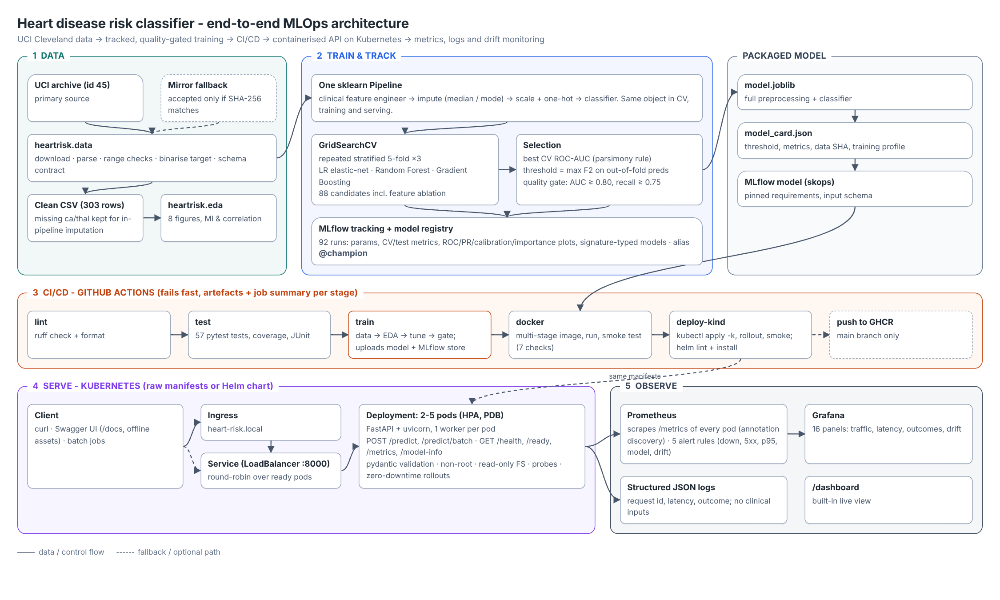

# Heart Disease Risk - End-to-End MLOps Pipeline

BITS Pilani WILP · **AIMLCZG523 Machine Learning Operations** · Assignment 1

A heart-disease risk classifier built on the UCI Heart Disease (Cleveland) dataset and taken all the way to a
monitored API on Kubernetes: checksum-verified data acquisition, EDA, a single leakage-free scikit-learn
pipeline, MLflow-tracked hyper-parameter search with a model registry, a quality-gated GitHub Actions
pipeline, a hardened Docker image, Kubernetes manifests plus a Helm chart, and Prometheus/Grafana monitoring
with input-drift signals.



| | |
|---|---|
| Champion model | Logistic regression (elastic-net search, chose L2), `C=0.1`, balanced class weights |
| Cross-validated ROC-AUC (repeated 5×3) | **0.899 ± 0.039** (random forest 0.894, gradient boosting 0.877) |
| Hold-out (61 patients) at threshold 0.31 | ROC-AUC 0.961 · recall **1.00** · precision 0.72 · accuracy 0.82 |
| External site (Hungarian, 293 patients) | ROC-AUC 0.894 · recall 0.80 |
| Serving latency (Kubernetes, live traffic) | p50 ≈ 15 ms · p95 ≈ 40 ms |
| Tests | 57 pytest tests, 91% line coverage, ruff-clean |

> Educational prototype. Not a medical device and not for clinical use.

---

## 1. Quick start

```bash
git clone https://github.com/princevashist1988/ML-Ops-Heart-Disease.git heart-risk-mlops && cd heart-risk-mlops
python3.12 -m venv .venv && source .venv/bin/activate      # Python 3.11-3.13 work
pip install -r requirements.txt                            # also installs this package (-e .)

make data      # download (UCI, verified fallback) + clean  -> data/processed/
make eda       # figures -> reports/figures/eda/
make train     # tune 3 model families, MLflow tracking, registry, quality gate (~3 min)
make test      # 57 unit tests + coverage
make serve     # API on http://localhost:8000/docs
```

Windows (PowerShell) users: replace `make <target>` with the command shown in `make help`
(e.g. `python -m heartrisk.train`). Conda alternative: `conda env create -f environment.yml`.

## 2. Repository layout

```
.github/workflows/ci-cd.yml   lint -> test -> train -> docker -> deploy-kind (+ GHCR push on main)
configs/train.yaml            every training choice (grids, CV, threshold policy, quality gate)
data/processed/               cleaned Cleveland (train/test) + Hungarian (external) CSVs, cleaning report
data/raw/                     populated by `make data` (not committed; provenance.json records SHA-256)
deploy/k8s/                   namespace, configmap, deployment, service (LB), ingress, HPA, PDB (kustomize)
deploy/helm/heart-risk-api/   the same deployment as a parameterised Helm chart
deploy/monitoring/            Prometheus config + alert rules, Grafana provisioning + dashboard, K8s stack
docker-compose.yml            API + Prometheus + Grafana locally
Dockerfile                    multi-stage, non-root, healthcheck, 1 worker/container
docs/                         architecture diagram, final report (docx), pipeline walkthrough video
models/                       packaged champion: model.joblib, model_card.json, mlflow_model/
notebooks/                    01 EDA · 02 training & tracking · 03 inference (executed)
reports/                      metrics.json, model_comparison.csv, mlflow_runs.csv, figures/
samples/                      example request payloads
screenshots/                  evidence for the report (MLflow, Prometheus, dashboard, terminal runs)
scripts/                      smoke test, local CI, traffic generator, Grafana dashboard builder
src/heartrisk/                the package: data, eda, features, models, train, evaluate, predict, api/
tests/                        pytest suite (data, features, model, training, API, inference, EDA)
```

## 3. Pipeline stages

### 3.1 Data acquisition and cleaning - `src/heartrisk/data.py`
* Sources tried in order: UCI zip → UCI legacy file → byte-identical GitHub mirrors → Weka ARFF (Hungarian only).
  The Cleveland file is accepted only if its SHA-256 equals `a74b7efa…27c8` (three independent copies agree),
  so a fallback can never silently change training data. Provenance is written to `data/raw/provenance.json`.
* Cleaning: `?` → NaN, physiologically impossible values → NaN (e.g. `chol = 0`), `num > 0` → `target = 1`,
  exact duplicates removed, nullable integer types. Missing values are **not** dropped: they are imputed inside
  the model pipeline, fitted on training folds only, so the same logic runs at inference.
* A schema contract (`data.validate`) guards training, tests and CI.

### 3.2 EDA - `src/heartrisk/eda.py`, `notebooks/01_eda.ipynb`
Class balance, missingness (train vs external site), distributions by class, box plots, disease rate per
category, Spearman heat-map, heart-rate-vs-age scatter and mutual information. Key finding: patients reaching
< 85% of age-predicted max heart rate have 72% disease prevalence vs 35% above it.

### 3.3 Features and models - `features.py`, `models.py`, `train.py`
* One `Pipeline`: `ClinicalFeatureEngineer` (heart-rate % of predicted max, hypertension flag) → cast →
  `ColumnTransformer` (median-impute + scale numerics, mode-impute binaries, mode-impute + one-hot categoricals)
  → classifier.
* Grid search with repeated stratified 5-fold CV (×3) over logistic regression (elastic-net path), random forest
  and gradient boosting - 88 candidates. The engineered features are a grid parameter, so the ablation is part
  of the search (result: no measurable gain, simpler set kept).
* Champion = best mean CV ROC-AUC (parsimony rule prefers the interpretable model within 0.01).
* Decision threshold = max F2 on **out-of-fold training** predictions with precision ≥ 0.6 (screening: a missed
  case costs more than a follow-up test). The test set is never used for selection.
* Quality gate: hold-out ROC-AUC ≥ 0.80 and recall ≥ 0.75, otherwise `train` exits 1 and CI fails.

### 3.4 Experiment tracking - MLflow
`mlflow ui --backend-store-uri sqlite:///mlflow.db` (or `make mlflow-ui`). Experiment `heart-disease-risk`:
one parent run per model family, a nested run per grid candidate (88), and a champion run with the model card,
plots, config and data provenance. The champion is registered as `heart-disease-classifier` with alias
`@champion`. Models are serialised with **skops** and an explicit allow-list instead of raw pickle.

### 3.5 Packaging and reproducibility
* `models/model.joblib` (serving), `models/mlflow_model/` (MLflow format with input schema and pinned
  requirements), `models/model_card.json` (threshold, metrics, data hash, training profile, environment).
* Pinned `requirements.txt` / `requirements-serve.txt` / `environment.yml`; seeds fixed; training is
  deterministic (re-runs reproduce identical CV scores).

## 4. Serving API - `src/heartrisk/api/`

| Endpoint | Purpose |
|---|---|
| `POST /predict` | one patient → `prediction`, `label`, `probability`, `confidence`, `risk_band`, `threshold` |
| `POST /predict/batch` | up to 256 patients |
| `GET /health`, `GET /ready` | liveness / readiness (model loaded) for Kubernetes probes |
| `GET /model-info` | model card summary |
| `GET /metrics` | Prometheus metrics |
| `GET /stats`, `GET /dashboard` | rolling 15-min summary and a live monitoring page |
| `GET /docs` | Swagger UI (assets vendored - works offline) |

```bash
curl -X POST localhost:8000/predict -H 'Content-Type: application/json' -d @samples/patient_high_risk.json
# {"prediction":1,"label":"heart disease","probability":0.9773,"confidence":0.9773,"risk_band":"high",
#  "threshold":0.31,"model_version":"heart-disease-classifier/v1","request_id":"..."}
```
Inputs are validated with pydantic using the same physiological ranges as the cleaner; `ca` and `thal` may be
omitted (imputed). Unknown fields are rejected (422).

## 5. Docker

```bash
docker build -t heart-risk-api:1.0.0 .
docker run -d --name heart-risk-api -p 8000:8000 heart-risk-api:1.0.0
bash scripts/smoke_test.sh http://localhost:8000   # 7 checks, non-zero exit on failure
```
Multi-stage build, non-root UID 10001, `HEALTHCHECK` on `/ready`, `BASE_IMAGE` build-arg for mirrored/air-gapped
registries. `docker compose up -d --build` adds Prometheus (`:9090`) and Grafana (`:3000`, admin/admin).

## 6. Kubernetes

**Minikube**
```bash
minikube start && minikube addons enable ingress && minikube addons enable metrics-server
minikube image load heart-risk-api:1.0.0           # or: eval $(minikube docker-env) && docker build ...
kubectl apply -k deploy/k8s && kubectl -n heart-risk rollout status deploy/heart-risk-api
minikube tunnel                                     # separate terminal: gives the LoadBalancer an IP
echo "$(minikube ip) heart-risk.local" | sudo tee -a /etc/hosts
bash scripts/smoke_test.sh http://heart-risk.local  # via Ingress
```
**Docker Desktop**: enable Kubernetes, build the image locally, `kubectl apply -k deploy/k8s`; the
LoadBalancer is served on `http://localhost:8000`.

**Helm** (alternative to the raw manifests):
```bash
helm upgrade --install heart-risk deploy/helm/heart-risk-api -n heart-risk --create-namespace
```
Manifests include rolling updates with `maxUnavailable: 0`, startup/readiness/liveness probes, resource
limits, HPA (2-5 pods on CPU), PodDisruptionBudget, a restricted security context and Prometheus annotations.

## 7. Monitoring and logging
* **Logs**: one JSON line per request (request id, endpoint, status, latency, outcome); clinical inputs are
  never logged. `X-Request-ID` is accepted and echoed for tracing.
* **Metrics**: request count/latency by endpoint and status, in-flight, inference time, predictions by
  outcome and risk band, probability histogram, validation errors, model info, live input means next to the
  training means (drift).
* **Prometheus**: `kubectl apply -k deploy/monitoring` (pod discovery + 5 alert rules) or docker compose.
* **Grafana**: provisioned 16-panel dashboard (`deploy/monitoring/grafana/dashboards/heart-risk-api.json`).
* **Traffic for demos**: `python scripts/generate_traffic.py --url http://heart-risk.local --minutes 3 [--drift]`.

## 8. CI/CD - `.github/workflows/ci-cd.yml`
`lint` (ruff) → `test` (pytest + coverage + JUnit) → `train` (data, EDA, training, quality gate) →
`docker` (build, run, smoke test, save image) → `deploy-kind` (kind cluster, `kubectl apply -k`, rollout,
smoke test, Helm lint + install). Each job uploads its logs/reports as artifacts and writes a Markdown
summary; any failing command fails the pipeline. On `main`, the image is pushed to GHCR.
Run the same stages locally with `bash scripts/ci_local.sh`.

## 9. Results summary

| Model | CV ROC-AUC | CV recall | Hold-out ROC-AUC |
|---|---|---|---|
| **Logistic regression** | **0.899 ± 0.039** | 0.792 | 0.961 |
| Random forest | 0.894 ± 0.041 | 0.768 | 0.956 |
| Gradient boosting | 0.877 ± 0.044 | 0.762 | 0.958 |

Threshold effect on the hold-out set: at 0.50 → 2 missed cases, 5 false alarms; at the chosen 0.31 → 0 missed
cases, 11 false alarms. The CV estimate (0.90) is the figure to quote; 61 hold-out patients is a small sample.

## 10. Reproducibility notes
The local evidence in `screenshots/` (MLflow, k3s, Prometheus, terminal runs) was produced on a Linux build
machine with restricted internet access and a single-node k3s cluster. Docker Hub and the UCI host were not
reachable from it, so the image was built with `--build-arg BASE_IMAGE=<local Ubuntu 24.04 + Python 3.12 base>`
and the Cleveland file came from the checksum-verified mirror (byte-identical to the UCI file).
The GitHub Actions run (`screenshots/github_actions_*.png`) uses the defaults - `python:3.12-slim` and the
standard data download (UCI first, verified fallback) - with no overrides, and passes all five jobs.
